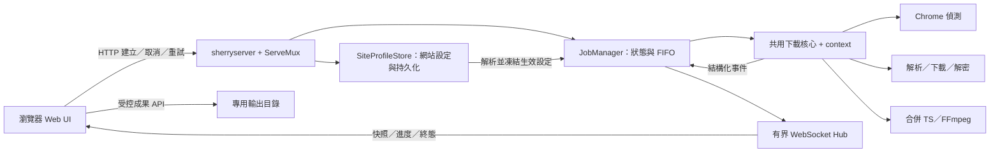

# Web 介面與 WebSocket 即時進度：功能規劃及執行計畫

規劃日期：2026-11-05（Asia/Taipei）  
狀態：P0–P6 與 P2a 已完成；本機驗收結果、實作決策及限制記錄於第 12 節。

## 1. 目標與第一版決策

使用 `github.com/asccclass/sherryserver` 為現有 M3U8 下載工具提供繁體中文 Web 介面，讓使用者透過瀏覽器建立下載任務、以 WebSocket 即時監控各處理階段，並取得完成的 MP4。CLI 與 Web 共用下載核心，保留原有 CLI 操作。

以下為本機單人版本的功能與執行依據；日後若要改為多人或公開服務，須另行調整範圍。

| 項目 | 第一版決策 |
| --- | --- |
| 使用情境 | 本機、單人；所有本機分頁共享同一份任務清單 |
| CLI 相容與部署 | 預設獨立 CLI，僅 `-web` 啟動 Web；CLI 不依賴 Web 設定或服務，可在其他主機獨立下載。遠端派工為未來擴充，見第 14 節 |
| 監聽 | `127.0.0.1:8080`，以 `-web` 啟動；可用 `-listen` 調整 loopback 位址及連接埠，第一版拒絕非 loopback 綁定 |
| 前端 | HTML、CSS、原生 JavaScript、瀏覽器原生 WebSocket；以 `go:embed` 隨執行檔打包，不需 Node.js 或外部 CDN |
| 任務排程 | FIFO；同時執行 1 個任務，任務內影片依捕獲順序逐一處理，影片內切片並行下載 |
| 儲存 | 任務與事件僅在記憶體；網站下載設定持久化至 `config/site-profiles.json`；敏感值預設不儲存，可由使用者明確選擇儲存；影片保存在專用輸出根目錄 |
| 歷史 | 同次服務期間可查詢；重啟後任務歷史清空，既有成果檔保留，但不自動重新匯入清單 |
| 預設容量 | 等待佇列上限 20；已結束任務最多保留 100 筆，超限移除最舊紀錄，不刪除成果檔；執行中任務不被淘汰 |
| 暫不納入 | 暫停／斷點續傳、跨重啟恢復、自動重試、多人帳號、遠端部署、直播持續錄製、畫質選單、DRM、瀏覽器登入／自動點擊播放 |

## 2. 現有程式與整合依據

### 2.1 實作前基準（供回歸比較）

以下記錄本次開發開始前的程式行為；已完成的核心拆分、取消控制與切片落盤見第 4、12 節。

- `main.go` 的 `run()` 整合參數驗證、偵測與批次下載；尚無 HTTP 路由、任務管理或結構化進度事件。
- `discoverM3U8()` 以 Chrome/Chromium 監聽網路請求，去除完全相同的 M3U8 URL；目前自行建立背景 context。
- `downloadPlaylist()` 負責解析、並行下載／AES-128 解密、依序合併 TS，再呼叫 FFmpeg 轉封裝。進度目前透過 `fmt.Printf` 輸出。
- `parsePlaylist()`、切片及金鑰下載使用 `http.Client.Get()`，取消尚未從外部傳入；FFmpeg 使用 `exec.Command()`，尚無任務取消控制。
- 多影片只要一筆失敗仍繼續；切片缺失不建立 MP4；轉封裝失敗保留 TS。Master playlist 只選第一個子清單。
- 現有 CLI 的 Cookie 僅傳給最初播放清單的相同主機與連接埠；自訂標頭不套用於偵測用瀏覽器。CLI 保留此行為；Web 網站設定新增獨立的偵測用／下載用標頭，Cookie 仍維持原始播放清單主機限制，詳見 3.4。
- 目前切片內容全部累積於記憶體後才合併；單任務佇列可限制同時工作量，但無法消除長影片的記憶體需求，見第 10 節。
- 現有 `main_test.go` 涵蓋直接輸入模式、來源標頭、Cookie 主機限制、403、重新導向、相對路徑、金鑰、循環引用與缺片處理，須持續通過。

### 2.2 sherryserver 查核結果及用法

以下依 2026-11-05 查閱的上游 `main` 原始碼；實作時須固定 tag 或 commit 對應的 Go module 版本，不以浮動 `latest` 作為交付依據。

| 已確認事項 | 對本專案的決策 |
| --- | --- |
| `NewServer(listenAddr, documentRoot, templatePath)` 回傳 `*Server`；可指定 `srv.Server.Handler`，上游提供 `srv.Start()` | 使用 `NewServer()` 建立的 HTTP Server，掛接本專案 ServeMux／內嵌前端；實際以 `srv.Server.Serve()` 配合應用程式 context 管理生命週期，理由見第 12 節 |
| `NewServer()` 必須讀到工作目錄的 `envfile`；`SessionCookieAuthKey` 至少 32 bytes，且不可沿用上游舊公開預設值 | 提供 `envfile.example` 與產生隨機金鑰的說明；啟動時檢查設定，錯誤明確回報，不在文件填入可直接沿用的固定密鑰 |
| 上游 `go.mod` 宣告 Go `1.27.0`；本專案宣告 `1.27.2`，上游文件的「1.25 以上」不足以代表目前 module 需求 | 以實際 `go.mod` 及本機工具鏈確認相容性，不自行降版 |
| `srv.Socketio` 底層使用 `github.com/coder/websocket`；名稱雖有 socketio，實際為原生 WebSocket | 前端使用 `new WebSocket(...)`，不引入 Socket.IO client |
| `BroadCastMessageWs()` 持鎖同步寫入每個訂閱者 channel；`Listen()` 未移除斷線訂閱者，且在握手成功前就加入訂閱 | 不直接使用此廣播器作為進度主通道；由本專案以同一 `coder/websocket` 套件實作有界佇列、移除訂閱、單一寫入者與寫入逾時；不修改上游 |
| `Socketio.AddRouter()` 同時公開任意訊息廣播 POST 端點 | 不呼叫此路由註冊器；僅註冊本專案的 `/ws` |
| `Start()` 內含 signal 與 15 秒 graceful shutdown，預設 HTTP 寫入逾時 10 秒 | 第一步驗證關閉時序與大檔傳輸；本專案須協調停止收件、取消工作、關閉 WebSocket 及等待清理，並為成果串流設定適當寫入期限 |

查核來源：[HTTP 服務原始碼](https://github.com/asccclass/sherryserver/blob/main/server.go)、[WebSocket 原始碼](https://github.com/asccclass/sherryserver/blob/main/libs/socketio/socketio.go)、[Go module](https://github.com/asccclass/sherryserver/blob/main/go.mod)、[上游使用說明](https://github.com/asccclass/sherryserver/blob/main/docs/README.md)。

## 3. 使用流程與介面功能

### 3.1 新增任務

先選擇「自動比對網站設定」、「指定網站設定」或「不使用網站設定」，再填入來源 URL。支援 `auto`、`page`、`m3u8`；`m3u8` 模式可處理無副檔名的播放清單。使用網站設定時，下載模式由設定決定。輸出為檔名，不接受任意伺服器路徑。

| 欄位 | 預設／限制 | 行為 |
| --- | --- | --- |
| URL | 必填，HTTP/HTTPS，不接受 URL userinfo | 前後端皆驗證；來源完整驗證參數只供核心使用 |
| 網站設定 | 自動比對；可手動指定或不使用 | 顯示命中依據、下載方式及生效參數；多筆命中時要求選取 |
| 模式 | 未使用設定時為 `auto` | 使用設定時依其模式決定，不以副檔名猜測覆蓋設定 |
| 輸出名稱 | `output.mp4`，上限 120 字元 | 只接受單一合法檔名；拒絕路徑分隔、`..`、Windows 保留名稱；統一 `.mp4` |
| 偵測等待秒數 | `6`，整數 0–300 | 僅 page／auto 判定為網頁時生效；明示這是頁面載入後的監聽時間 |
| 切片並行數 | `6`，整數 1–16 | 限制同一影片同時下載切片數 |
| 保留 TS | `false` | 成功後依設定保留；FFmpeg 失敗一律保留已合併 TS |
| Referer、User-Agent、Cookie、自訂 Header／Query | 選填，置於進階設定 | 可繼承網站設定或只覆蓋本次；敏感值遮蔽、不回填、不寫入 localStorage；另按「儲存網站設定」才會持久化 |

提交成功後立即取得任務 ID 並顯示於佇列，不在 HTTP request 內等待下載完成。防止連點以相同 `Idempotency-Key` 建立重複任務；使用者主動再次提交可產生新 key。

### 3.2 任務列表及詳情

- 列表顯示：任務 ID、輸出名稱、來源主機／遮罩後路徑、狀態、當前階段、影片成功／失敗／總數、建立時間、執行耗時及可用操作。
- 詳情顯示：偵測到的清單數、每支影片的處理階段、切片成功／失敗／總數、切片處理百分比、已收取位元組、近期吞吐量及錯誤摘要。
- 解析或偵測尚未結束時總數未知，顯示「偵測中／解析中」及不定進度，不宣稱完整任務百分比。
- 合併、轉封裝第一版顯示階段及經過時間，不捏造百分比或 ETA；FFmpeg 成功、成果發布完成後才顯示影片完成。
- 總覽顯示等待中、執行中、成功、部分成功、失敗、取消數量；終態任務可依狀態篩選。
- 日誌依時間排列，限制每任務最近 500 筆；DOM 使用純文字呈現來源錯誤，避免 HTML 注入。UI 明示較舊日誌可能已淘汰。
- 頁首顯示 WebSocket「連線中／已連線／重連中／離線」；斷線時保留最後快照並標記資料可能過期，任務仍在伺服器繼續。
- 支援桌面與手機寬度，進度不僅依賴顏色，表單有 label，按鈕可用鍵盤操作。

### 3.3 取消、重試與成果

- 等待中可直接取消；執行中先進入 `cancelling`，取消 HTTP、Chrome 與 FFmpeg，等待 worker 結束與檔案清理後進入 `cancelled`。取消優先於一般下載失敗，不繼續下一影片。
- 已完成的影片仍保留並可下載。取消導致的未完成 MP4 不可發布；已合併 TS 依 `keepTs` 保留，FFmpeg 非取消失敗則一律保留 TS。
- 僅 `failed`、`partial_failed` 可手動重試。重試建立新任務、以 `retryOf` 連回原任務，不改寫原任務終態。
- 已有影片清單時只重試失敗影片，保留原影片索引／檔名對應，不覆寫成功成果；偵測失敗尚無清單時才重新偵測。已取消任務若要重做，透過新增任務操作。
- 任務使用的 Cookie 副本在終態後清除；未儲存的 Cookie 重試前須重新輸入。若網站設定已明確儲存 Cookie，重試時可由使用者選擇「重新套用目前網站設定」，顯示版本，不從舊任務公開資料取回秘密。URL 過期時以新 URL 建立任務，不保證舊來源可重用。
- 每任務使用獨立目錄 `<outputRoot>/<jobId>/`，重試亦使用新目錄。同名任務互不覆寫，多影片沿用 `_001.mp4` 命名。
- 完成檔案透過任務／影片 ID 對應的 API 下載；預設只提供 MP4。TS 路徑只在本機日誌／狀態中以受控相對名稱提示，不提供任意路徑讀取端點。
- 已結束任務提供「刪除任務與檔案」：確認後刪除整個任務輸出目錄（含 MP4、TS、暫存檔）及任務紀錄。檔案已搬移／刪除時只清理剩餘目錄；目錄或任務已不存在時仍視為成功。執行中、取消中及等待中的工作不可直接刪除，需先取消並結束。

### 3.4 可自訂及儲存的網站下載設定（Site Profile）

#### 3.4.1 設定管理與儲存

新增「網站下載設定」管理頁，支援新增、編輯、複製、停用、刪除。新增網站不需修改 Go 程式；使用者可先設定名稱、網域、下載方式及參數，再於新增任務時選取。

| 設定欄位 | 行為 |
| --- | --- |
| 名稱、ID、啟用狀態、revision | ID 不隨更名改變；修改採版本檢查，避免多分頁互相覆寫 |
| 網站網域 `pageHosts` | 比對頁面網址，例如 `missav.ai`；預設精確 hostname，比對子網域須明確啟用，可限制 port |
| 媒體網域 `mediaHosts` | 比對直接 M3U8 網址，例如 `surrit.com`；與頁面網站分開設定，皆可多筆 |
| 模式 | `m3u8` 僅直接播放清單；`page` 先偵測頁面；`auto` 沿用一般辨識 |
| 下載標頭 `downloadHeaders` | Referer、User-Agent、Origin、Cookie 及自訂 Header，供播放清單、子清單、切片、金鑰使用 |
| 偵測標頭 `browserHeaders` | 獨立設定 Chrome 偵測使用的 User-Agent、Referer 及自訂 Header，預設不繼承下載標頭；第一版拒絕瀏覽器 Cookie，下載 Cookie 仍可設定 |
| Query 預設參數 `queryDefaults` | key/value，作用範圍為 `page` 或 `playlist` 入口；只補原 URL 缺少的 key，不覆蓋既有值，不改變子清單／切片／金鑰的現有 URL 解析規則 |
| 下載參數 | waitSeconds、concurrency、keepTs，限制與任務表單相同；輸出名稱仍由任務指定 |
| 標頭目標 `targetHosts` | 每筆標頭指定可傳送的主機與可選 port；預設僅該階段入口 URL 的同一主機與 port，跨主機及重新導向須重新檢查 |
| 敏感值保存 | Cookie、Authorization、自訂敏感 Header／Query 預設僅本次使用；使用者明確勾選才持久化 |

網站設定保存在 `config/site-profiles.json`，包含 `schemaVersion`，重啟後仍可使用；任務歷史仍不持久化。採寫入鎖與同目錄暫存後原子替換，成功落盤才回應成功，失敗保留舊版。檔案損壞時保留原檔並報錯，不以空設定覆蓋。

設定檔不放在靜態目錄、不加入版本控制。第一版本機檔案為明文，儲存敏感值時直接說明；Unix 限服務帳號讀寫，Windows 限服務帳號及必要管理者 ACL，無法限制存取時拒絕保存敏感值，仍可單次輸入。

設定讀取 API 僅回傳非敏感值及敏感欄位 `hasValue`／`persisted`，不回傳既有秘密明文；編輯時分別提供保留、替換、清除。Referer 等非敏感範本可於設定編輯頁讀寫，但其中 Query 值預設視為敏感。單次敏感值隨任務提交，不因儲存其他欄位而默默寫入設定檔。

#### 3.4.2 辨識與套用規則

1. 明確選取設定時以該設定為準，且輸入須符合相應網域；不符合則提示修改設定或改用「不使用設定」，不默默轉用其他網站參數。
2. 自動比對依正規化 hostname（小寫、IDN、去尾端句點）、port 及明確的子網域規則，禁止字串包含比對；`missav.ai.evil.example` 不命中 `missav.ai`。
3. 唯一命中時預選並顯示原因；多筆命中時必須讓使用者選取，例如多個網站使用相同 CDN，不以建立順序猜測。
4. `m3u8` 設定若命中頁面網站，只顯示「請提供直接 M3U8 URL」，不得啟動頁面偵測。無命中時可使用一般模式，並可另存本次設定。
5. 生效順序為「系統預設 → 選定網站設定 → 本次明確覆蓋」。未提供欄位表示繼承，清除以明確操作表示；Header 名稱大小寫不敏感。Query 預設只補缺值。
6. 本次可覆蓋 Header、Query 與下載參數；模式由設定決定，要更換模式需編輯設定或選擇不使用設定。提交前顯示最終模式、設定名稱／版本與非敏感參數，後端重新驗證。
7. 前端提交 `profileId`、`profileRevision`；版本已變則回 409，重新預覽後再送。接受任務時凍結生效快照，後續修改／停用／刪除設定不改變已接受的任務。
8. 停用設定不參與比對且不能建立新任務。重試保留原非敏感快照；敏感值重新提供或明確重新套用目前設定，不靜默換版本。

`m3u8` 模式允許無副檔名 URL，以有效 M3U8 內容驗證；收到 HTML 時回報「此設定需要直接 M3U8 URL」，不自動改成 page 模式。

Cookie 即使另設 targetHosts，仍只傳給最初 M3U8 的同一主機及 port；Authorization 等敏感 Header 僅傳至明確允許的目標。Chrome 的敏感標頭必須以逐請求主機檢查套用，不能全域注入到第三方資源。此新行為限 Web 設定模式，保留原 CLI 行為。

「相關參數」限本節列出的型別化欄位；不接受任意 shell 參數、FFmpeg 指令、瀏覽器啟動參數、Host／Content-Length／Connection 等連線標頭。第一版不含任意程式碼、登入腳本、動態 Query 簽章產生器。

#### 3.4.3 使用者提供的範例設定

以下依需求提供可編輯範本，尚未對真實網站下載驗證；驗收使用等價本機 fixture，不保證來源永久可用。範本需由使用者另存，不在每次啟動覆蓋既有設定。

| 項目 | MissAV：直接 M3U8 | HL365：網頁偵測 |
| --- | --- | --- |
| pageHosts | `missav.ai` | `hl365.com` |
| mediaHosts | `surrit.com` | 使用者依實際來源補充，不預先猜測 |
| 模式 | `m3u8`，只接受播放清單 | `page`，Chrome 捕獲 M3U8 後逐一下載 |
| 輸入範例 | `https://surrit.com/8ef39691-6a8c-4c09-a28c-53460d3ff227/720p/video.m3u8` | `https://hl365.com/archives/222115.html` |
| 下載 Referer | `https://missav.ai/`，目標 `surrit.com:443` | 預設不強加，使用者可自行設定 |
| 下載 User-Agent | 下方範例，可儲存及修改 | 預設不強加，使用者可自行設定 |
| 等待 | 不使用、不要求 Chrome | 預設 6 秒，可儲存其他值 |

MissAV User-Agent 範例：

```text
Mozilla/5.0 (Windows NT 10.0; Win64; x64) AppleWebKit/537.36 (KHTML, like Gecko) Chrome/142.0.0.0 Safari/537.36
```

因此，選擇 MissAV 後直接填入 surrit.com 的 M3U8，套用已儲存的 Referer／User-Agent；選擇 HL365 後填入網頁網址，先進行偵測再下載。設定可複製成其他網站；不自動從 MissAV 網頁取得直接網址。

## 4. 執行架構與狀態模型



實際檔案：`main.go` 為 CLI／Web 入口，`downloader.go` 為可取消的下載／偵測核心，`playlist.go` 為解析／解密與相容 wrapper 的輔助函式，`web.go` 提供 HTTP 與 API，`jobs.go` 管理任務及進度，`websocket.go` 管理連線，`web/` 為內嵌前端。

`site_profiles.go` 集中網站設定儲存／版本／公開 DTO、網域比對及參數合併；`storage_windows.go`／`storage_unix.go` 提供權限限制與原子替換；`config.go` 產生個人 envfile。任務核心只接受已解析的型別化選項，不重新讀取設定檔。

核心接受 `context.Context`、型別化選項與事件 callback；CLI 將相同事件格式化為終端機訊息。不得透過解析 stdout 推算狀態，也不得讓 WebSocket I/O 阻塞切片 worker。

### 4.1 任務與影片

| 模型 | 主要資料 |
| --- | --- |
| Job | ID、retryOf、profileId／名稱／版本、非敏感生效設定快照、遮罩後輸入、mode、選項、state、phase、建立／開始／結束時間、影片統計、revision、錯誤摘要 |
| SiteProfile | ID、名稱、啟用狀態、revision、pageHosts、mediaHosts、模式、Header／Query／下載參數；秘密與公開 DTO 分離 |
| Video | 穩定 ID、原始索引、遮罩後來源、state、phase、切片統計、接收位元組、吞吐量、成果 ID、錯誤摘要 |
| Artifact | ID、jobId、videoId、受控相對檔名、檔案大小、發布完成旗標 |
| 私有輸入 | 完整 URL／來源標頭；與對外 DTO 分離，不可直接 JSON 序列化內部 Job |

任務狀態為 `queued → running → succeeded / partial_failed / failed`，或 `queued → cancelled`、`running → cancelling → cancelled`。`running` 的 phase 為 `discovering / parsing / downloading / merging / remuxing`；多影片期間 phase 隨當前影片切換。影片具有獨立狀態，待處理影片因任務取消而標為取消。

- 全部影片成功：`succeeded`；部分成功且部分失敗：`partial_failed`；偵測失敗、零清單或全部失敗：`failed`。
- 每支影片一般失敗後繼續下一支；任務取消時保留既有成果，任務終態仍為 `cancelled`。
- JobManager 為狀態唯一寫入者，使用鎖或單一事件迴圈保護；API、worker、WebSocket 讀取一致快照。
- 完成／失敗／取消競態必須經同一同步機制決定：終態只能設定一次；已發布成功的影片不可被遲到取消事件改寫。
- HTTP 使用附帶 context 的 request；下載、金鑰及播放清單沿用 30 秒請求逾時；Chrome 繼承任務 context；FFmpeg 使用 `exec.CommandContext` 並測試子程序回收。

## 5. HTTP API 草案

路徑統一為 `/api/v1`；除了成果下載，其餘使用 JSON。錯誤格式為 `{"error":{"code":"INVALID_INPUT","message":"…"}}`，不得原樣回傳含來源憑證的底層錯誤。

| Method／路徑 | 功能與成功回應 | 主要錯誤 |
| --- | --- | --- |
| `GET /` | Web UI | — |
| `GET /api/v1/health` | `200`，服務版本、FFmpeg／Chrome 可用性、容量限制；不含環境變數值 | — |
| `GET /api/v1/site-profile-templates` | `200`，可編輯的 MissAV／HL365 範本，不自動儲存 | — |
| `GET /api/v1/site-profiles` | `200`，設定清單與版本，敏感值僅顯示是否存在 | — |
| `GET /api/v1/site-profiles/{id}` | `200`，可編輯非敏感設定與敏感欄位狀態 | `404` |
| `POST /api/v1/site-profiles` | `201`，驗證並落盤，回傳公開設定及 Location | `400` 設定無效；`500` 無法持久化 |
| `PUT /api/v1/site-profiles/{id}` | `200`，body 帶 revision，更新／停用並落盤 | `400`；`404`；`409` 版本衝突；`500` |
| `DELETE /api/v1/site-profiles/{id}` | `204`，以 If-Match 帶 revision，刪除並落盤 | `404`；`409` 版本衝突；`500` |
| `POST /api/v1/site-profiles/resolve` | `200`，依 URL／手動選擇回傳候選、生效模式及遮罩預覽；不連線到來源、不下載 | `400`；`404` 指定設定不存在；`409` 多筆命中／停用／版本不符 |
| `POST /api/v1/jobs` | `202`，回傳 Job 快照與 `Location`；支援 `Idempotency-Key` | `400` 輸入無效；`409` 相同 key 不同內容；`429` 佇列已滿；`503` 必要相依不可用 |
| `GET /api/v1/jobs` | `200`，有界任務快照集合及全域 revision | — |
| `GET /api/v1/jobs/{id}` | `200`，Job、Video、成果及有界日誌 | `404` 無此任務／已淘汰 |
| `DELETE /api/v1/jobs/{id}` | `204`，移除已結束任務的輸出目錄及紀錄，透過 job.removed 同步分頁；找不到檔案、目錄或重複刪除皆成功 | `400` 無效 ID；`409` 尚未結束或目錄位置異常；`500 DELETE_FAILED` 真正的存取／檔案占用錯誤 |
| `POST /api/v1/jobs/{id}/cancel` | `202`，返回當前快照；重複取消仍回傳當前取消狀態 | `404`；`409` 已以成功／失敗終結 |
| `POST /api/v1/jobs/{id}/retry` | `202`，建立重試 Job；body 可提供新的來源標頭，支援冪等 key | `400`；`404`；`409` 不是可重試終態；`429`；`503` |
| `GET /api/v1/jobs/{id}/videos/{videoId}/file` | `200` 或 Range 的 `206`，MP4 附件 | `404`；`409` 成果尚未就緒；`416` 無效 Range |
| `GET /ws` | WebSocket upgrade，接收快照與事件 | `403` Origin／Host 不允許；`503` 連線容量已滿 |

未使用網站設定的建立任務 body 範例：

```json
{
  "url": "https://example.com/index.m3u8",
  "profileSelection": "none",
  "mode": "m3u8",
  "outputName": "movie.mp4",
  "waitSeconds": 6,
  "concurrency": 6,
  "keepTs": false,
  "headers": {"referer": "https://example.com/watch", "userAgent": "", "cookie": ""}
}
```

使用網站設定時，先 resolve 預覽，再以選定的 ID／revision 建立任務；只提供需要覆蓋的欄位，省略的欄位繼承設定。例如：

```json
{
  "url": "https://surrit.com/8ef39691-6a8c-4c09-a28c-53460d3ff227/720p/video.m3u8",
  "profileSelection": "explicit",
  "profileId": "missav-direct",
  "profileRevision": 1,
  "outputName": "out.mp4",
  "concurrency": 6
}
```

`profileSelection` 可為 `none / auto / explicit`；auto 亦須攜帶預覽選定的 ID／revision，後端重新比對，結果不同回 409。若無命中，改為 none 模式提交。設定模式請求不得帶與設定衝突的 mode。任務建立與重試新增 `PROFILE_CONFLICT` 類 409，設定持久化錯誤不得回傳假成功。Header／Query 覆蓋使用具名稱、值、清除動作、敏感標記及目標範圍的型別化結構；內建 Referer／User-Agent／Cookie 也走相同驗證與合併機制。

冪等 key 在本次服務記憶體內保留至對應任務淘汰；重複請求在此期間回傳同一 Job，不重複加入佇列。所有寫入端點限制 body 大小（64 KiB）、驗證 Content-Type 並拒絕不支援的標頭名稱。

## 6. WebSocket 契約與即時性

### 6.1 事件

每次連線成功由伺服器主動推送 `snapshot`。實際事件類型為 `job.created`、`job.updated`、`job.finished`、`job.removed` 與 `heartbeat`。Job 事件直接攜帶完整任務、影片及有界日誌，統一更新，不另傳 video.updated／log 差額事件。`job.finished` 攜帶任一終態；單人模式推送全體有界任務，不另設任務訂閱指令。

```json
{
  "schemaVersion": 1,
  "instanceId": "server-instance-id",
  "seq": 42,
  "type": "job.updated",
  "timestamp": "2026-11-05T09:00:00+08:00",
  "jobId": "job-id",
  "data": {
    "id": "job-id",
    "source": "https://example.com/…",
    "outputName": "movie.mp4",
    "mode": "m3u8",
    "options": {"waitSeconds": 6, "concurrency": 6, "keepTs": false, "downloadHeaders": [], "browserHeaders": []},
    "state": "running",
    "phase": "downloading",
    "createdAt": "2026-11-05T08:59:00+08:00",
    "startedAt": "2026-11-05T08:59:00+08:00",
    "succeeded": 0,
    "failed": 0,
    "revision": 8,
    "videos": [{
      "id": "video-id", "index": 1, "source": "https://example.com/…", "outputName": "movie.mp4",
      "state": "running", "phase": "downloading", "segmentsTotal": 100,
      "segmentsSucceeded": 50, "segmentsFailed": 0, "segmentsProcessed": 50,
      "segmentProgressPercent": 50, "bytesReceived": 10485760, "bytesPerSecond": 2097152,
      "size": 0, "ready": false, "revision": 7
    }],
    "logs": [{"time": "2026-11-05T08:59:00+08:00", "message": "處理階段：downloading"}]
  }
}
```

- `seq` 是每條連線的嚴格遞增訊息序號；不同連線不比較 seq。`instanceId` 每次服務啟動更新；`revision` 為模型版本，用於拒絕舊更新。
- `snapshot.data` 包含有界任務、影片、近期日誌及全域 revision；連線時的「註冊訂閱者＋取得快照」須原子化，快照先寫、後續變更再依序寫出，避免初始化漏事件或舊快照覆蓋新狀態。
- `job.updated` 傳完整公開任務（含影片及日誌），而非必須逐條累加的差額；`job.finished` 包含最終 Job、Video 與成果摘要。`job.removed` 通知前端移除已淘汰歷史。
- `segmentsProcessed = succeeded + failed`；百分比是已處理切片／總切片，含失敗也可能達 100%。UI 必須標示「切片處理」，同列呈現成功／失敗，不能當作影片成功。
- `bytesReceived` 計算影片切片實際收到的資料，不含播放清單或金鑰；下載讀取時累計，吞吐量取最近 3 秒變化，沒有新資料後下降至零，不以解密後長度冒充網路速率。

### 6.2 推送、重連及資源管理

- 統計事件最多每任務每 250 ms 推送一次，可合併中間更新；階段與終態立即排程。正常本機負載下，變更至 UI 可見不超過 1 秒。
- 每連線一個寫入迴圈、有界 128 則待送訊息、單次寫入逾時 5 秒；快慢客戶端彼此獨立。佇列滿時關閉慢速連線，讓其重連取完整快照，不阻塞工作或無限堆積。
- 重要狀態先寫入 JobManager，再發送事件；終態即使遇到斷線也能由快照／GET 查回。心跳、階段變化與日誌同樣走單一寫入者。
- 每 15 秒發送 heartbeat，包含服務時間及全域 revision；客戶端超過 45 秒未收到任何訊息，主動重連。服務設 Ping／讀取與寫入期限以回收失效連線。
- 前端以 1、2、4、8 秒退避，之後最多 15 秒，加入 jitter；連線恢復後等待新快照再宣告資料已同步。前端自動重連只恢復監控，不重新送出建立任務。
- 第一版每次重連取完整快照，不提供事件重播；新 instanceId 清空舊記憶體狀態。HTTP GET 可供手動重新整理／偵錯，正常進度不靠輪詢。
- 最多 16 條 WebSocket 連線；握手成功才註冊，讀寫失敗、取消及服務關閉時移除訂閱、停止 timer、釋放 goroutine。連線未成功也不得殘留訂閱。

## 7. 檔案、存取與錯誤處理

- Web 預設輸出根目錄 `downloads/`，只允許啟動設定指定根目錄；建立前檢查可寫入。UI 要說明這是伺服器檔案位置，瀏覽器另以下載按鈕取得。
- MP4 先在同一任務目錄以暫存名稱產生，FFmpeg 成功且檔案關閉後才發布最終檔名與 Artifact；取消或失敗清除未完成 MP4，避免殘檔被當成果。
- 成果 API 僅依內部已登錄的 ID 找檔案，檢查正規化路徑仍在輸出根目錄內，拒絕符號連結／junction 逃逸。不以 `/downloads/` 靜態目錄暴露磁碟內容。
- 使用附件 Content-Disposition，支援 Range；驗證大於 10 秒的傳輸不受上游預設 WriteTimeout 中斷，下載 request 取消時停止串流，不重啟影片工作。
- API 與 WebSocket 驗證 Host、同源 Origin 及寫入請求來源，拒絕跨站建立／取消任務；不可把 CORS 回應標頭當成存取控制。第一版只接受設定的 loopback 來源。
- Cookie、Authorization、URL userinfo 及 URL query 值不得出現在 API 回應、WebSocket、前端／服務日誌。來源完整 URL 與底層錯誤需先遮罩，無法可靠拆解的錯誤採固定摘要；Referer 等含 query 的值也須處理。使用者輸入／更新設定的 request 可含必要值，既有秘密不回傳；設定編輯頁僅可讀回非敏感範本。
- FFmpeg 以參數陣列執行，不拼接 shell；驗證標頭不可含 CR/LF。狀態事件不得攜帶 AES 金鑰或原始來源標頭。
- 偵測零筆、HTTP 403、播放清單錯誤、金鑰錯誤、切片缺失、磁碟寫入失敗、FFmpeg 失敗均需映射到明確錯誤階段及可理解訊息。
- Web 啟動不因 Chrome 缺失整體失敗：health 顯示不可用並拒絕 page 類任務；auto 判定為直接播放清單仍可使用。FFmpeg 缺失時 UI 可開啟，但拒絕建立需要它的下載工作。

## 8. 分階段執行計畫

依 P0 → P1 → P2a → P2 → P3 → P4 → P5 → P6 執行。P2a 為網站設定工作；下列勾選依實作與測試更新，詳細結果見第 12 節。

| 階段 | 待辦項目 | 交付內容 | 驗收對應／前置條件 |
| --- | --- | --- | --- |
| P0 相依與啟動驗證 | [x] 固定 sherryserver 版本；確認 Go 相容性、envfile、密鑰與路由；驗證原生 WebSocket upgrade、長連線、關閉時序及大檔逾時調整 | `go.mod/go.sum`、最小整合、`envfile.example` | A01、A14；先解決上游整合限制，不修改上游或改用其他 HTTP 框架 |
| P1 共用下載核心 | [x] 將核心與 CLI 入口分離；導入 context、型別化事件、位元組計數；所有網路請求與 FFmpeg 可取消；成果暫存後發布 | 共用 runner、CLI 事件輸出、保留相容 wrapper | A02、A05、A08、A09；P0 完成 |
| P2a 網站設定 | [x] SiteProfile schema／CRUD／版本、原子落盤、秘密保存選項；主機比對、歧義處理、合併預覽；偵測／下載分開套用標頭與 Query；提供 MissAV／HL365 可編輯範本 | SiteProfileStore、resolver、套用邏輯及測試 | A16–A23；P1 完成 |
| P2 任務與排程 | [x] Job／Video 狀態機、有界 FIFO、容量限制、冪等、失敗重試、日誌上限、私有輸入與公開 DTO 分離；接受時凍結網站設定快照 | JobManager 及行為測試 | A03、A04、A08、A10、A13、A20；P2a 完成 |
| P3 HTTP 與成果 | [x] 註冊任務／網站設定／resolve API、參數驗證、Origin／Host、受控檔案下載、Range、health、統一錯誤、輸出隔離 | Web API 與整合測試 | A03、A09、A11、A12、A14、A16–A23；P2 完成 |
| P4 WebSocket | [x] 初始原子快照、事件契約、合併節流、心跳、連線限制、慢速客戶端回收、資源清理 | 進度 Hub 與連線整合測試 | A05、A06、A07、A13；P2/P3 完成 |
| P5 Web UI | [x] 繁中表單、網站設定管理／選取／預覽／儲存、佇列與詳情、階段進度、連線狀態、取消與重試、成果下載、行動版及鍵盤操作 | `web/` 內嵌前端、操作流程 | A03–A12、A15–A23；P3/P4 完成 |
| P6 驗收與文件 | [x] 執行回歸、競態測試與端到端情境；更新啟動／設定／限制／網站範例／驗收紀錄；確認服務關閉後無殘留程序 | README、本文件的實測結果、可執行建置 | 全部 A01–A23；P0–P5 及 P2a 完成 |

實際啟動方式（首次先執行 `go run . -init-config`，已有 envfile 時不重複建立）：

```powershell
go run . -web -listen "127.0.0.1:8080"
go build -o m3u8-dl.exe .
.\m3u8-dl.exe -web -listen "127.0.0.1:8080"
```

文件須提醒：拆成多個 Go 檔案後應以 `go run .` 啟動。原有 CLI 旗標、下載結果及錯誤語意保留；README 中的 `go run main.go` 範例同步調整。

## 9. 驗收條件

測試素材以本機 `httptest`、可控延遲／錯誤來源及短 TS／AES-128 fixture 為主。FFmpeg／Chrome 真實端到端另列必要環境，不能只依賴可能過期或需登入的外部網址。測試對應與實際結果見第 12 節；真實網站示例未執行外部下載。

| ID | 情境與可判定通過條件 |
| --- | --- |
| A01 | 設定有效 envfile 後以 `-web` 啟動，瀏覽器可開啟首頁；API、靜態檔與 `/ws` 同埠且由 sherryserver 提供。缺少 envfile／金鑰或埠已占用時有明確錯誤，無假成功訊息。非 loopback listen 被拒絕。 |
| A02 | 原有 `go test ./...` 案例全部通過；CLI 直接 M3U8、page、標頭、Cookie 主機限制、編號及遇錯繼續行為不退化。測試依賴缺失而 skip 須在紀錄明示，不當作該情境已驗收。 |
| A03 | 有效任務以 202 回應並立即顯示；相同冪等 key 重送只產生一個 ID。非法 URL、模式、檔名、並行數、等待時間、CR/LF 標頭回 400 且不排程。兩個同名任務輸出互不覆寫。 |
| A04 | 使用阻塞來源連續建立 3 筆任務，確認僅 1 筆 running、另外依 FIFO 等待；同影片活躍切片請求不超過設定值。等待數超過 20 回 429，取消等待工作後名額恢復。 |
| A05 | 以至少 20 片、可控制回應時序的來源，核對成功／失敗／總數、接收位元組及處理百分比正確。穩定本機環境下，每次可觀察狀態變化至畫面更新 ≤1 秒；階段與終態不被節流遺漏。停止資料傳輸後吞吐量在 3 秒視窗結束後回到零。 |
| A06 | 關閉／恢復瀏覽器網路，任務繼續且不重複建立；重連獲得最新快照。刻意在握手及快照期間完成影片，畫面仍與 GET 查詢一致；服務重啟後以新 instanceId 清除舊任務顯示。 |
| A07 | 開啟正常與不讀取訊息的慢速 WebSocket，慢速者被逾時／容量機制移除，正常者與下載不受阻塞。持續連線超過 60 秒並收到 heartbeat；反覆連線／斷線 100 次及握手失敗後，訂閱數回歸初始值，無持續增長的 goroutine。第 17 條同時連線回 503。 |
| A08 | 分別在等待、偵測、切片下載、合併及 FFmpeg 階段取消。受控本機 fixture 下，5 秒內 worker、Chrome／FFmpeg 結束，狀態到 cancelled，後續影片不再執行；無未完成 MP4 可下載。完成與取消競態只產生一個終態，已成功影片仍可下載。 |
| A09 | 切片缺失時不發布 MP4；所有切片處理完但仍合併／轉封裝時，UI 不顯示影片成功。FFmpeg 失敗顯示 remuxing 階段錯誤並保留 TS；成功結果經 ffprobe／播放確認有效。磁碟寫入失敗時正確結束，佇列可繼續。 |
| A10 | 偵測到 3 個來源，其中 1 個故意失敗，其他完成並為 partial_failed；只重試失敗影片且產生新任務／目錄，原成功檔不變、原索引不重編。全失敗為 failed；零捕獲有明確提示。重試 Cookie 重新輸入或明確重新套用目前已保存設定，既有秘密不從 API 取回。 |
| A11 | 完成 MP4 可下載，Content-Disposition 與檔名正確；Range 回 206，檔案內容與磁碟一致。以節流連線持續下載超過 10 秒仍完成；未完成成果回 409，未知 ID 回 404。 |
| A12 | 路徑穿越、絕對路徑、Windows 保留名稱、符號連結／junction 逃逸、偽造 Host、跨站 HTTP 寫入及跨站 WebSocket 均被拒絕；`/downloads/` 與任意訊息廣播端點不開放。將測試 Cookie、token、Referer query 注入來源錯誤，確認回應、WS、前端及服務日誌均無明文洩漏。 |
| A13 | 保留上限與日誌上限生效，淘汰事件同步到所有分頁；連續建立／取消與多分頁並行監控不出現資料競爭或終態倒退。`go test -race ./...` 在支援 race 的環境通過，並檢查慢速／斷線客戶端不阻塞工作。 |
| A14 | 缺 Chrome 時直接 M3U8 仍可執行，page 任務清楚拒絕；缺 FFmpeg 可開 UI 但下載建立回 503。Ctrl+C 後停止收件，取消任務、關閉 WS 並在 15 秒關閉期限內退出，無遺留 Chrome、FFmpeg、暫存未完成 MP4。 |
| A15 | 桌面與 375px 寬度可完成新增→監控→下載／取消→重試流程，無水平溢出妨礙操作；鍵盤可操作表單與按鈕，錯誤可見。暫停一般 HTTP 輪詢仍可收到進度；DevTools 可確認更新經 WebSocket 傳輸。 |
| A16 | 新增、編輯、複製、停用、刪除自訂網站設定均可操作；儲存後重啟仍存在。模擬唯讀目錄、寫入失敗及損壞檔案，明確報錯且原檔不被破壞；多分頁版本衝突回 409。 |
| A17 | 以 MissAV 等價 fixture 選取「直接 M3U8」，媒體主機收到設定的 Referer／完整 User-Agent，播放清單、切片及金鑰皆正確套用；不啟動 Chrome，無 Chrome 仍可下載。輸入頁面或回傳 HTML 時拒絕／報錯，不偷偷偵測頁面。無副檔名的有效 M3U8 仍可下載。 |
| A18 | 以 HL365 等價 fixture 選取「網頁偵測」，Chrome 開啟輸入頁面，捕獲 M3U8 後自動下載；waitSeconds 生效。分別核對 browserHeaders 與 downloadHeaders 在各自階段使用，不誤互相繼承。 |
| A19 | pageHosts／mediaHosts 能分別辨識頁面網站與 CDN；大小寫／IDN／port／子網域規則正確，惡意相似網域不命中。同一 CDN 命中兩筆設定時要求選取；無命中可用一般模式；停用設定不被套用。 |
| A20 | 預設→設定→本次覆蓋的值正確，繼承／清除可區別，Header 大小寫不產生重複值。Query 只補指定入口缺少的 key，不覆蓋既有簽章值。修改／刪除設定不影響已排隊任務；舊預覽版本提交回 409；重試不默默換版本。 |
| A21 | 非敏感 Header／參數重啟可重用；未勾選保存的 Cookie 不落盤，明確保存後可在新任務重用。讀取／編輯 API 不回傳秘密明文，保留／替換／清除均正確；權限不足時拒絕保存敏感值。任務、WS、日誌及靜態路由不洩漏設定檔／秘密。 |
| A22 | 以跨主機及重新導向 fixture 驗證 Header 目標限制；Cookie 不離開最初播放清單主機及 port，Authorization 不傳給未允許主機，Chrome 不將敏感值注入第三方資源。CR/LF、連線控制 Header、任意指令及無效參數均拒絕；原 CLI 標頭行為不退化。 |
| A23 | 使用者可從範本另存、切換 MissAV／HL365、修改並另存第三個網站，再只填對應 URL 與輸出名稱建立任務。可見模式及生效預覽，單次覆蓋不改寫儲存值；既有範本不覆蓋自訂設定。全流程不需要新增網站專屬 Go 分支。 |
| A24 | 已結束任務可於 UI 刪除，MP4／TS／暫存目錄及紀錄一併移除；MP4 已搬移時仍成功清理原目錄且不影響搬移後的檔案。目錄已不存在或重複刪除回 204；其他分頁收到 job.removed。等待／執行／取消中回 409；跨站及目錄穿越被拒絕；目錄內 junction 不可導致刪除外部檔案。 |
| A25 | 未加 `-web` 的獨立 CLI 程序在沒有或存在損壞的 Web envfile／網站設定時，仍可用原有參數直接下載；`-url` 可啟動自身 Chrome 偵測。輸出寫入 CLI 主機指定路徑，不建立 Web 設定／downloads 目錄；失敗回傳結束碼 1，且不發布缺片影片。 |

開發驗證指令（實作階段執行）：

```powershell
go test ./...
go vet ./...
go test -race ./...
go build -o m3u8-dl.exe .
```

Windows race 測試若缺受支援的 C 工具鏈，須記錄原因並在具備工具鏈的環境補驗；不得默認通過。瀏覽器端驗收記錄桌面／手機視窗、連線中斷及實際操作結果。

## 10. 已知限制與後續決策

- 本機單人服務不承諾對外部署安全；若改為區網／公開服務，另規劃帳號權限、TLS、來源 URL 的 SSRF／重新導向／DNS 防護、磁碟配額及成果隔離，並調整本文件的 loopback 限制。
- 已採切片落盤及依序合併，不再於記憶體累積整部影片；單片上限 64 MiB，記憶體需求仍隨並行數與單片大小增長，磁碟需容納切片、TS 及 MP4。第一版未實作磁碟配額，不承諾任意大小影片。
- 服務重啟後無任務歷史／自動續作，但網站下載設定保留；輸出檔不自動刪除。可在 UI 手動刪除仍有紀錄的已結束任務及其目錄；重啟後的舊檔仍需使用者自行管理。
- 不自動繼承瀏覽器登入、不繞過驗證、不保證 403 可由補標頭解決；畫質與多影片去重沿用現況。
- 執行途中若需改變本機單人、歷史持久化或下載資源上限等產品假設，再針對具體影響詢問；其餘依本文件預設推進。

## 11. 交付與驗證紀錄

- [x] 檢視 `main.go`、`main_test.go`、README 與 `go.mod`。
- [x] 查閱 sherryserver HTTP／WebSocket 原始碼、設定及 module 需求。
- [x] 定義第一版功能、整合方案、API／事件契約、P0–P6 及 P2a 工作與 A01–A23 驗收條件。
- [x] 補入可儲存／選取／自行定義的網站下載設定、網頁與媒體網域區分、模式與 Header／Query／參數、MissAV／HL365 範例。
- [x] 完成功能實作與本機可執行驗收；實際環境限制明列於下節。

已完成下載核心、網站設定、HTTP／WebSocket 與前端實作；驗證紀錄如下。

## 12. 實作交付與驗收結果（2026-11-05）

### 12.1 環境及建置

- Windows amd64、Go `1.27.2`，本機 Google Chrome、FFmpeg／ffprobe；race 使用現有 MinGW GCC。
- 固定 `github.com/asccclass/sherryserver v1.1.1-0.20261103030302-52974b0c4fb8`（commit `52974b0c4fb8`），WebSocket 使用 `github.com/coder/websocket v1.8.13`。
- `go test ./...` 的原有測試與新增整合案例已執行；完整競態驗收 `go test -race ./... -count=1 -timeout 180s -json` 通過，耗時約 85.9 秒。
- 最後新增吞吐量歸零案例與修整後，以 `go test -race -short ./... -count=1 -timeout 120s -json` 回歸通過，耗時約 18.1 秒。short 僅略過已於完整驗收通過的 60 秒心跳與長檔案傳輸測試。
- 兩輪共涵蓋 **31 個不同頂層測試、另含 6 個子案例**；`go vet ./...`、`node --check web/app.js` 與 `go build -o m3u8-dl.exe .` 通過。
- 已產生 `m3u8-dl.exe` 及個人隨機金鑰 `envfile`；以實際執行檔啟動後，首頁、JS、CSS、網站設定與範本 API 均回 200，WebSocket 收到 schemaVersion 1 的初始快照。檢查用服務已停止，不佔用使用者的連接埠。
- 執行紀錄：`test-results/go-test.jsonl`、`test-results/go-test-short.jsonl`；Chrome 畫面：`test-results/desktop.png`、`test-results/mobile.png`。這些是本機驗證產物，已加入 `.gitignore`。

### 12.2 驗收對應

以下「通過」以本機可控 fixture 及所列測試為準，不代表已對所有外部網站、作業系統或實體手機驗證。

| 條件 | 結果及證據 |
| --- | --- |
| A01 啟動與設定 | 通過 `TestSherryStartupConfigAndGracefulShutdown`；驗證缺設定、loopback 限制、埠占用、個人設定不覆寫及實際 sherryserver HTTP 啟停；另通過執行檔 smoke 檢查。 |
| A02 CLI 回歸 | 原有 `main_test.go` 全部通過，包含來源標頭、Cookie 主機限制、403、直接模式、相對路徑、重新導向、金鑰及缺片。多檔案程式改以 `go run .` 啟動，README 已同步。 |
| A03 建立與驗證 | `TestAPIProfilesAndGuards`、`TestWebDownloadAESProgressFilesAndIdempotency`、`TestValidationAndHeaderScopes` 驗證 202、冪等重送、相同 key 不同內容 409、非法輸入與檔名拒絕。 |
| A04 排程 | `TestQueueCancelAndFrozenProfile`、`TestFIFOOrder` 驗證 1 個執行、20 個等待、超額 429、取消釋放名額及 FIFO；AES 下載案例驗證切片同時請求不超過 3。 |
| A05 進度 | AES fixture 驗證 20 片、位元組、成功／失敗與各階段；Chrome 案例量測終態事件至 DOM 更新 ≤1 秒；`TestThroughputReturnsToZeroDuringSilentSegment` 驗證靜默期間吞吐量回零。 |
| A06 重連 | `TestWebDownloadAESProgressFilesAndIdempotency`、`TestBrowserDesktopMobileAndDownloadWorkflow` 驗證重連快照與終態仍在，且不重複建立任務；新服務使用新的 instanceId。 |
| A07 連線生命週期 | `TestWebSocketLifecycleAndLimits` 驗證 100 次連線／斷線回收及第 17 條連線拒絕；`TestHubSlowClientAndHistoryBounds` 驗證滿佇列移除慢速客戶端；長連線約 60.03 秒收到 4 次 heartbeat。 |
| A08 取消 | `TestCoreCancelStagesAndRemuxFailure`、`TestCancelActiveRemux`、瀏覽器偵測及佇列案例驗證各階段取消、FFmpeg 回收與未完成檔案清理；已成功成果仍保留。 |
| A09 成果及錯誤 | AES 成果經 ffprobe 確認為 MP4；缺片不建立 MP4，無效媒體轉封裝失敗保留 TS，`TestDiskFailureKeepTSAndHTMLRejection` 驗證磁碟錯誤及 keepTs。 |
| A10 批次與重試 | Chrome 等價頁面捕獲 3 筆、2 成功 1 失敗；重試僅下載失敗筆，保留 `batch_002.mp4` 編號且不改寫原目錄。 |
| A11 檔案下載 | Range 回 206，越界 416，ffprobe 確認成果；`TestLargeFileTransferPastServerTimeout` 在伺服器寫入期限設 1 秒下，持續約 11.52 秒完整接收 10 MiB 檔案。 |
| A12 路徑與來源限制 | API guard、Header scope、秘密遮罩案例通過；`TestWindowsJunctionCannotEscapeOutputRoot` 實際建立 junction 並確認外部成果回 404。Windows 無建立 symbolic link 權限，該分支未執行；以可建立的 junction 補驗同一 `os.Root` 隔離邊界。 |
| A13 有界資料與競態 | 完整及最後 short 的 `-race` 均通過；歷史 100、日誌 500、慢速訂閱及重複監控測試通過。取消等待任務會立即移出排程列並執行歷史淘汰。 |
| A14 相依及關閉 | 注入缺 Chrome／FFmpeg 情境驗證各模式的 503／可用性；實際啟動關閉案例同時關閉 WebSocket 與執行中的 HTTP 工作，5 秒內退出；Chrome 與 FFmpeg 另有取消案例。 |
| A15 瀏覽器介面 | Chrome 1440×1000 及 375px viewport 無水平溢出；實際表單保存設定、提交／下載、重連及 Tab 鍵移動通過。正常進度由 WebSocket 事件更新，無定時 HTTP 任務輪詢。 |
| A16 設定持久化 | `TestProfilePersistenceSecretsAndVersion`、`TestProfileWriteFailureAndCorruptionPreservesOriginal` 驗證重開保留、更新／刪除、版本衝突、落盤失敗不提交記憶體及損壞檔案不覆寫。 |
| A17 直接下載設定 | 媒體／頁面網域模式限制、無副檔名 M3U8、Header 套用、HTML 拒絕及不需 Chrome 分支均通過。 |
| A18 網頁偵測設定 | `TestBrowserDiscoveryHeadersPartialRetryAndCancel` 使用 Chrome 真正開啟 fixture 頁面、捕獲清單後下載；分別確認 browserHeaders／downloadHeaders。 |
| A19 網站辨識 | profile resolver 驗證精確網域、子網域、IDN、port、相似惡意網域拒絕及共享 CDN 歧義；停用／明確選取採後端檢查。 |
| A20 設定快照 | 預設與單次覆蓋、Header 大小寫、Query 缺值補入且保留簽章原始編碼、舊 revision 409、排隊設定凍結及重試編號案例通過。 |
| A21 秘密保存 | 已保存 Cookie 重開可用，未勾選敏感值不落盤；公開 DTO 不回傳秘密，保留／清除、原子寫入與秘密錯誤遮罩案例通過。 |
| A22 Header／參數範圍 | 下載重新導向不跨主機洩漏 Cookie／Authorization；Chrome fixture 不將敏感 Header 傳至第三方；CR/LF、連線控制 Header、萬用字元敏感目標等會拒絕。 |
| A23 使用者自訂 | Chrome 透過可見表單將 MissAV 範本改成自訂測試網站並儲存，任務自動選用並下載；另以 HL365 等價 page profile 完成批次下載。網站行為由資料設定，無網站專屬下載分支。 |

### 12.3 實作決策與交付邊界

1. 使用 sherryserver 的 `NewServer()` 及其 `http.Server`，由應用程式呼叫 `Serve()` 並集中管理 signal／context／15 秒關閉期限。上游 `Start()` 會自行監聽 signal 並在錯誤時呼叫 Logger.Fatal，無法讓呼叫端可靠等待下載清理；此調整保留指定的 HTTP 套件，且未修改上游。
2. WebSocket 自行管理有界訂閱與寫入者；影片與日誌收斂到完整 `job.updated`，避免多種差額事件競態。訂閱與初始快照在相同狀態鎖下完成。
3. 共用核心採切片落盤而非整部影片保留於記憶體；單片限制 64 MiB，磁碟與並行數仍需依環境選用。已保留的 TS 以受控相對檔名在影片詳情提示。
4. 保存秘密為使用者明確選取的本機明文保存；Windows 使用服務帳號限定的 DACL，Unix 目錄 0700／檔案 0600。偵測瀏覽器第一版不接受 Cookie Header，下載 Cookie 可使用；自動登入仍在範圍之外。
5. 真實 MissAV／HL365 網站、外部驗證流程、Linux 執行環境及實體手機未做端到端測試。範本依使用者需求提供，HTTP 403、過期簽章或網站需登入／點擊時仍可能失敗，不宣稱可繞過來源限制。

啟動已建置版本：

```powershell
.\m3u8-dl.exe -web
```

開啟 `http://127.0.0.1:8080`。新增工作區或重新取得原始碼時，先依 README 執行 `go run . -init-config`，不要複製他人的個人金鑰。

## 13. 成果刪除增補

- [x] 新增 `DELETE /api/v1/jobs/{id}`，僅刪除已結束任務；成功清理目錄後才移除紀錄及冪等快取。
- [x] 使用已驗證的任務 ID、絕對路徑範圍檢查及 `os.Root` 限制清理位置；不跟隨 junction／符號連結遞迴刪除外部資料。
- [x] 檔案搬移、單檔／目錄不存在、重複刪除皆成功，不回報檔案不存在錯誤；真實權限或占用錯誤仍保留紀錄並提示重試。
- [x] UI 提供含整個目錄範圍說明的刪除確認，成功後以 `job.removed` 同步其他分頁。
- [x] 新增檔案刪除、搬移後清理、重複刪除、執行中拒絕與 Windows nested junction 測試；Chrome 流程補驗先搬移 MP4 再按 UI 刪除，原檔保留且原目錄清除。

驗收條件 A24 對應 `delete_test.go`、`TestDeleteJobDoesNotFollowNestedJunction` 及延伸的 `TestBrowserDesktopMobileAndDownloadWorkflow`；使用完整 short 競態回歸、靜態檢查及重新建置執行檔驗證本次變更。

## 14. CLI 獨立執行與未來分主機部署

### 14.1 持續保留的相容條件

- CLI 是獨立執行模式，不是 Web API 的必要客戶端；不帶 `-web` 時直接執行共用下載核心，不啟動 HTTP／WebSocket 服務、不讀取或建立 Web 的 envfile／網站設定。
- 保留 `-url`、`-m3u8`、`-mode`、`-out`、`-wait`、`-c`、`-keep-ts`、`-referer`、`-user-agent`、`-cookie`。多檔案原始碼使用 `go run .`；編譯後可直接執行，不需攜帶 Go 原始碼、web/ 靜態檔或安裝 Node.js。
- CLI 執行主機需具備 FFmpeg，page 模式另需 Chrome／Chromium；不需要 Web 主機在線。CLI 輸出及保留 TS 均位於執行主機的 `-out` 路徑，相對路徑以該程序工作目錄為準。
- CLI 與 Web 目前可各自在不同主機獨立執行，同一主機也可使用不同輸出位置同時工作。任務、佇列、設定及檔案不自動共享；Web 的刪除功能不會跨主機刪除 CLI 成果。
- CLI 保持本機直接執行及失敗非零結束碼；日後即使新增遠端 worker，也不可強迫現有 CLI 連線 Web 才能下載。

### 14.2 未來 Web 派工至遠端下載主機（規劃，尚未實作）

此情境不同於兩種模式各自下載；目前 Web API／WebSocket 僅處理同一 Web 程序管理的本機工作，沒有遠端 CLI 派工、跨主機進度或檔案同步功能。

若未來需要此架構，預留以下邊界：

1. 共用下載核心繼續只接受型別化選項、context、結構化進度 callback，不讀取 Web 服務的全域設定。Web 的本機工作已採此方式呼叫。
2. 加入獨立的執行介面，區分本機 runner 與遠端 worker；CLI 原本的直接下載模式不變，worker 作為額外啟動模式或另一個命令入口。
3. Web 傳送可版本化的任務參數快照，worker 回報 taskId／workerId、進度、終態及心跳；協定另設認證、TLS、取消確認、重送冪等、斷線恢復與明確失聯狀態，不解析終端機文字推算進度。
4. 檔案歸 worker 主機所有。Web 以 artifact ID 取得、串流或要求 worker 刪除成果，不將遠端路徑當作 Web 本機路徑呼叫 RemoveAll；遠端檔案已搬移／不存在時，同樣以成功清理其原工作目錄處理。
5. 不依賴共用磁碟路徑或共享記憶體。跨主機成果下載、保存憑證的傳送範圍與 worker 授權需在實作該階段時一併定義。

本次未開放非 loopback Web 監聽，也未新增尚無部署需求的遠端服務。

### 14.3 CLI 回歸驗證

`cli_test.go` 透過隔離工作目錄與獨立子程序執行實際 `main()` 入口：

- `TestCLIStandaloneWithoutWebConfiguration`：Web 設定不存在／損壞兩種情境，使用原有 Header 參數下載有效 MP4，且不建立 Web 工作目錄或設定。
- `TestCLIStandalonePageDiscovery`：以原有 `-url -mode page -wait` 偵測測試網頁並輸出 MP4。
- `TestCLIStandaloneFailureExitStatus`：缺片時程序結束碼為 1，保留錯誤摘要且不建立不完整 MP4。

上述對應 A25，並與原有直接輸入模式、標頭及 Web 的 short 競態回歸一併驗證。
